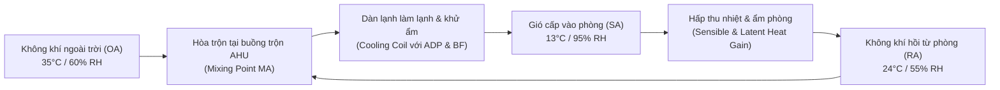

# BÀI GIẢNG 01: NHIỆT ẨM HỌC ỨNG DỤNG & PHƯƠNG PHÁP TÍNH TẢI LÀM LẠNH RTS
## (Dành cho Kỹ sư Thiết kế HVAC & Kiểm toán viên Năng lượng Công trình)

---

### MỤC TIÊU BÀI HỌC
Sau khi hoàn thành bài giảng này, kỹ sư có thể:
1. **Làm chủ bản chất vật lý của không khí ẩm:** Hiểu sâu sắc 7 thông số nhiệt ẩm, nguồn gốc phương trình ASHRAE Fundamentals Ch. 1, và ý nghĩa của chúng trong việc kiểm soát vi khí hậu, đọng sương, nồm ẩm công trình.
2. **Phân tích và tính toán các quá trình nhiệt ẩm:** Hòa trộn dòng khí, làm lạnh khử ẩm có xét điểm đọng sương thiết bị (ADP), hệ số lọt gió (Bypass Factor) và hệ số nhiệt hiện (SHR).
3. **Hiểu bản chất phương pháp RTS (Radiant Time Series) của ASHRAE:** Phân biệt rõ sự khác nhau giữa Nhiệt hấp thụ tức thời (Heat Gain) và Tải làm lạnh (Cooling Load) thông qua quán tính nhiệt kết cấu công trình.
4. **Triển khai tính toán tải nhiệt thực tế cho dự án:** Tự tay lập bảng tính, chọn thông số biên khí hậu theo QCVN 02:2022/BXD, kiểm soát tải gió tươi theo ASHRAE 62.1 và TCVN 5687:2024.

---

## PHẦN 1: BẢN CHẤT VẬT LÝ CỦA KHÔNG KHÍ ẨM (PSYCHROMETRICS)

### 1.1 Khái niệm & Áp suất Khí quyển
Không khí trong điều hòa không khí là hỗn hợp cơ học giữa **Không khí khô (Dry Air)** và **Hơi nước (Water Vapor)**.
Theo định luật áp suất riêng phần Dalton:
$$P_{atm} = P_{da} + P_w$$
Trong đó:
- $P_{atm}$: Áp suất khí quyển tổng (ở mực nước biển tiêu chuẩn là $101,325\text{ Pa}$ hay $101.325\text{ kPa}$).
- $P_{da}$: Áp suất riêng phần của không khí khô.
- $P_w$: Áp suất riêng phần của hơi nước trong không khí.

> **LƯU Ý KỸ THUẬT QUAN TRỌNG:** Áp suất khí quyển giảm dần theo độ cao. Khi thiết kế cho các dự án ở vùng cao (Đà Lạt $\sim 1500\text{ m}$, Sa Pa $\sim 1600\text{ m}$), $P_{atm}$ chỉ còn khoảng $85\text{ kPa}$. Áp suất thấp hơn làm thay đổi thể tích riêng $v$ và dung ẩm $W$, nếu kỹ sư dùng bảng tra mực nước biển sẽ bị sai lệch lưu lượng quạt tới $15\% - 18\%$!

### 1.2 Bảy thông số trạng thái cơ bản & Phương trình ASHRAE

1. **Nhiệt độ bầu khô ($T_{db}$ - Dry-Bulb Temperature):** Là nhiệt độ đo bằng nhiệt kế thông thường không bị ảnh hưởng bởi độ ẩm hay bức xạ nhiệt.
2. **Áp suất hơi nước bão hòa ($P_{ws}$):** Áp suất hơi nước cực đại mà không khí có thể chứa ở nhiệt độ $T$ nhất định. Theo ASHRAE Fundamentals 2017/2021 Ch. 1 Eq. 5 & 6 (dải $0^\circ C$ đến $200^\circ C$):
   $$\ln(P_{ws}) = \frac{C_8}{T} + C_9 + C_{10} T + C_{11} T^2 + C_{12} T^3 + C_{13} \ln(T)$$
   Với $T = T_{db} + 273.15\text{ (K)}$, và các hằng số:
   - $C_8 = -5.8002206 \times 10^3$
   - $C_9 = 1.3914993$
   - $C_{10} = -4.8640239 \times 10^{-2}$
   - $C_{11} = 4.1764768 \times 10^{-5}$
   - $C_{12} = -1.4452093 \times 10^{-8}$
   - $C_{13} = 6.5459673$
3. **Độ ẩm tương đối ($RH$ hoặc $\phi$):**
   $$\phi = \frac{P_w}{P_{ws}} \times 100\%$$
4. **Dung ẩm tuyệt đối ($W$ - Humidity Ratio):** Khối lượng hơi nước trên một đơn vị khối lượng không khí khô ($kg_w / kg_{da}$ hoặc $g_w / kg_{da}$):
   $$W = \frac{M_w}{M_{da}} \cdot \frac{P_w}{P_{atm} - P_w} = 0.621945 \cdot \frac{P_w}{P_{atm} - P_w}$$
5. **Enthalpy không khí ẩm ($h$):** Tổng nhiệt năng chứa trong hỗn hợp không khí khô và hơi nước ($kJ/kg_{da}$):
   $$h = c_{pa} \cdot T_{db} + W \cdot (h_{fg0} + c_{pw} \cdot T_{db}) = 1.006 \cdot T_{db} + W \cdot (2501.0 + 1.86 \cdot T_{db})$$
   - $1.006\text{ kJ/(kg.K)}$: Nhiệt dung riêng đẳng áp của không khí khô.
   - $2501.0\text{ kJ/kg}$: Ẩn nhiệt hóa hơi của nước ở $0^\circ C$.
   - $1.86\text{ kJ/(kg.K)}$: Nhiệt dung riêng của hơi nước.
6. **Thể tích riêng ($v$ - Specific Volume):** Thể tích chiếm bởi $1\text{ kg}$ không khí khô kèm lượng hơi nước tương ứng ($m^3/kg_{da}$):
   $$v = \frac{R_{da} \cdot T \cdot (1 + 1.607858 \cdot W)}{P_{atm}} \quad (R_{da} = 287.042\text{ J/kg.K})$$
7. **Nhiệt độ đọng sương ($T_{dp}$ - Dew-Point Temperature):** Là nhiệt độ mà tại đó hơi nước trong không khí bắt đầu ngưng tụ thành giọt sương khi làm lạnh đẳng áp và đẳng dung ẩm:
   $$\alpha = \ln(P_w / 1000.0) \quad (P_w \text{ tính bằng kPa})$$
   $$T_{dp} = 6.54 + 14.526 \alpha + 0.7389 \alpha^2 + 0.09486 \alpha^3 + 0.4569 (P_w / 1000.0)^{0.1984}$$

---

## PHẦN 2: BỐN QUÁ TRÌNH NHIỆT ẨM THỰC CHIẾN TRÊN ĐỒ THỊ MOLLIER / PSYCHROMETRIC

### 2.1 Quá trình hòa trộn hai dòng không khí (Airstream Mixing)
Khi hòa trộn dòng gió tươi ngoài trời $OA$ (lưu lượng khối lượng $\dot{m}_o$, enthalpy $h_o$, dung ẩm $W_o$) với dòng gió hồi $RA$ ($\dot{m}_r, h_r, W_r$):
Theo định luật bảo toàn khối lượng và năng lượng:
$$\dot{m}_m = \dot{m}_o + \dot{m}_r$$
$$W_m = \frac{\dot{m}_o W_o + \dot{m}_r W_r}{\dot{m}_m}$$
$$h_m = \frac{\dot{m}_o h_o + \dot{m}_r h_r}{\dot{m}_m}$$
$$T_{m} \approx \frac{\dot{m}_o T_o + \dot{m}_r T_r}{\dot{m}_m}$$
> Điểm hòa trộn $M$ luôn nằm trên đoạn thẳng nối giữa điểm $O$ và điểm $R$ trên đồ thị Psychrometric, chia đoạn thẳng theo tỷ lệ nghịch với lưu lượng khối lượng.

### 2.2 Quá trình làm lạnh và khử ẩm qua dàn coil (Cooling & Dehumidification)
Khi không khí đi qua dàn coil nước lạnh hoặc gas giãn nở trực tiếp (DX), bề mặt cánh nhôm/ống đồng có nhiệt độ thấp hơn nhiệt độ đọng sương của không khí vào ($T_{surface} < T_{dp}$).
- **Điểm đọng sương bề mặt thiết bị (ADP - Apparatus Dew Point):** Là giao điểm của đường biểu diễn quá trình làm lạnh kéo dài với đường bão hòa ($100\%\text{ RH}$).
- **Hệ số lọt gió (BF - Bypass Factor):** Một phần không khí đi qua dàn coil không tiếp xúc với bề mặt ống cánh mà đi lọt qua khe hở:
  $$BF = \frac{T_{leaving} - T_{adp}}{T_{entering} - T_{adp}} = \frac{W_{leaving} - W_{adp}}{W_{entering} - W_{adp}}$$
  - Dàn AHU cao cấp (6 - 8 hàng ống): $BF \approx 0.05 - 0.10$.
  - Dàn FCU tiêu chuẩn (3 - 4 hàng ống): $BF \approx 0.15 - 0.25$.
- **Hệ số nhiệt hiện (SHR - Sensible Heat Ratio):**
  $$SHR = \frac{Q_{sensible}}{Q_{total}} = \frac{Q_{sensible}}{Q_{sensible} + Q_{latent}} = \frac{1.006 \cdot \Delta T}{\Delta h}$$

---

## PHẦN 3: PHƯƠNG PHÁP TÍNH TẢI ĐỈNH RTS CỦA ASHRAE (RADIANT TIME SERIES)

### 3.1 Bản chất vật lý: Heat Gain vs Cooling Load
Rất nhiều kỹ sư mới vào nghề thường nhầm lẫn giữa **Lượng nhiệt đi vào phòng (Heat Gain)** và **Tải làm lạnh của điều hòa (Cooling Load)**:
1. **Nhiệt dẫn truyền và đối lưu (Convective Heat Gain):** Nhiệt sinh ra từ đèn, người, thiết bị dưới dạng đối lưu sẽ làm nóng không khí trong phòng tức thời $\rightarrow$ Trở thành Cooling Load ngay lập tức.
2. **Nhiệt bức xạ (Radiant Heat Gain):** Bức xạ mặt trời qua kính, bức xạ từ người và đèn chiếu sáng không làm nóng không khí trực tiếp mà truyền tới các bề mặt kết cấu bao che (sàn bê tông, tường xây, đồ đạc).
3. **Quán tính nhiệt (Thermal Mass Delay):** Kết cấu hấp thụ nhiệt bức xạ, nóng dần lên, sau đó mới từ từ truyền nhiệt đối lưu vào không khí phòng theo thời gian (kéo dài từ 2 đến 8 tiếng). Do đó:
   $$\text{Peak Cooling Load} < \text{Peak Heat Gain}$$
Phương pháp RTS của ASHRAE sử dụng chuỗi hệ số phân rã bức xạ 24 giờ (Radiant Time Factors - RTF) để tính toán chính xác đỉnh tải làm lạnh, tránh việc chọn thừa công suất thiết bị gây lãng phí đầu tư CAPEX.

### 3.2 Các thành phần tải lạnh chi tiết

#### A. Tải truyền nhiệt qua vỏ đục (Tường & Mái):
$$Q_{envelope} = U \cdot A \cdot \Delta T_{sol-air}$$
Trong đó:
- $U$: Hệ số truyền nhiệt của kết cấu ($W/m^2.K$).
- $A$: Diện tích bề mặt ($m^2$).
- $\Delta T_{sol-air}$: Chênh lệch nhiệt độ mặt trời tương đương (Sol-air temperature) có xét đến bức xạ mặt trời hấp thụ trên bề mặt ngoài:
  $$T_{sol-air} = T_{outdoor} + \frac{\alpha \cdot I_{total}}{h_o} - \frac{\epsilon \cdot \Delta R}{h_o}$$
  - $\alpha$: Hệ số hấp thụ bức xạ của màu sơn tường (sơn trắng $\sim 0.45$, sơn xám/đậm $\sim 0.85$).
  - $I_{total}$: Tổng thông lượng bức xạ mặt trời chiếu vào bề mặt ($W/m^2$).

#### B. Tải nhiệt qua cửa kính (Fenestration):
Gồm 2 thành phần độc lập:
1. **Dẫn nhiệt do chênh lệch nhiệt độ:** $Q_{glass\_cond} = U_{glass} \cdot A_{glass} \cdot (T_{outdoor} - T_{indoor})$
2. **Bức xạ nhiệt mặt trời xuyên qua kính:**
   $$Q_{solar} = A_{glass} \cdot SHGC \cdot I_{peak} \cdot IAC$$
   - $SHGC$ (Solar Heat Gain Coefficient): Hệ số hấp thụ nhiệt mặt trời của hệ kính (kính trắng đơn $\sim 0.82$, kính hộp Low-E $\sim 0.28 - 0.35$).
   - $IAC$ (Interior Shading Attenuation Coefficient): Hệ số suy giảm của rèm che bên trong (rèm lá sách sáng màu $IAC \approx 0.60 - 0.70$).

#### C. Tải nhiệt nội vi (Internal Heat Gains):
1. **Người (Occupancy):**
   - $Q_{occ\_sensible} = N \times q_s$ ($q_s \approx 75\text{ W}$ cho nhân viên văn phòng ngồi tĩnh tại).
   - $Q_{occ\_latent} = N \times q_l$ ($q_l \approx 55\text{ W}$ cho nhân viên văn phòng tỏa ẩm qua mồ hôi/hơi thở).
2. **Chiếu sáng (Lighting):** $Q_{lighting} = A_{floor} \times LPD\text{ (W/m2)} \times F_{use} \times F_{special}$
3. **Thiết bị cắm ổ cắm (Plug Loads):** $Q_{plug} = A_{floor} \times W_{plug}\text{ (W/m2)}$ (Văn phòng trung bình $\sim 10 - 15\text{ W/m2}$).

#### D. Tải xử lý gió tươi (Ventilation Load):
Lưu lượng gió tươi được tính theo ASHRAE Standard 62.1 (Breathing Zone Outdoor Airflow):
$$V_{bz} = R_p \cdot P_z + R_a \cdot A_z$$
- Văn phòng: $R_p = 2.5\text{ L/(s.người)}$, $R_a = 0.3\text{ L/(s.m2)}$.
Tải nhiệt gió tươi đưa vào dàn coil:
$$Q_{vent\_total} = \rho \cdot V_{bz} \cdot (h_{outdoor} - h_{indoor}) \approx 1.204 \cdot V_{bz}\text{ (m3/s)} \cdot \Delta h\text{ (kJ/kg)}$$
$$Q_{vent\_sensible} \approx 1.21 \cdot V_{bz}\text{ (L/s)} \cdot \Delta T\text{ (K)}$$
$$Q_{vent\_latent} \approx 3010 \cdot V_{bz}\text{ (L/s)} \cdot \Delta W\text{ (kg/kg)}$$

---

## PHẦN 4: CASE STUDY THỰC HÀNH - TÍNH TẢI SÀN VĂN PHÒNG 1,000 M2 TẠI TP. HCM

### 4.1 Đề bài & Dữ liệu đầu vào:
* **Công trình:** Sàn văn phòng mở tầng 8, Tòa nhà thương mại tại Quận 1, TP. Hồ Chí Minh.
* **Thông số kiến trúc:**
  - Diện tích sàn: $1,000\text{ m}^2$, chiều cao thông thủy trần $H = 2.8\text{ m}$.
  - Tường ngoài hướng Tây: Diện tích tường đục $A_{wall} = 150\text{ m}^2$ ($U = 1.8\text{ W/m}^2.K$).
  - Kính hướng Tây: $A_{glass} = 120\text{ m}^2$ (Kính hộp Low-E có $U = 2.2\text{ W/m}^2.K$, $SHGC = 0.30$, rèm che sáng màu $IAC = 0.70$).
  - Mật độ người: 100 người ($10\text{ m}^2/\text{người}$).
  - Đèn LED tiết kiệm: $LPD = 6.5\text{ W/m}^2$.
  - Thiết bị máy tính: $12.0\text{ W/m}^2$.
* **Điều kiện biên thiết kế:**
  - Ngoài trời (QCVN 02:2022 mùa hè TP. HCM): $T_{db} = 35.0^\circ C, T_{wb} = 28.0^\circ C \Rightarrow h_o = 90.23\text{ kJ/kg}, W_o = 21.44\text{ g/kg}$.
  - Trong nhà (ASHRAE 55): $T_{db} = 24.0^\circ C, RH = 55\% \Rightarrow h_i = 50.22\text{ kJ/kg}, W_i = 10.24\text{ g/kg}$.

### 4.2 Các bước tính toán chi tiết:
1. **Lưu lượng gió tươi:**
   $$V_{bz} = (2.5 \times 100) + (0.3 \times 1000) = 250 + 300 = 550\text{ L/s} = 0.55\text{ m}^3/\text{s} = 1,980\text{ m}^3/\text{h}$$
2. **Tải gió tươi:**
   $$Q_{vent\_total} = 1.204 \times 0.55 \times (90.23 - 50.22) \times 1000 = 26,494\text{ W} \approx 26.5\text{ kW}$$
   - $Q_{vent\_s} = 1.21 \times 550 \times (35.0 - 24.0) = 7,320\text{ W} = 7.32\text{ kW}$
   - $Q_{vent\_l} = 26.49 - 7.32 = 19.17\text{ kW}$ (Nhận thấy trong khí hậu nhiệt đới, tải ẩn gió tươi chiếm tới $72\%$ tổng tải gió tươi!).
3. **Tải bức xạ & dẫn nhiệt qua kính hướng Tây:**
   - Dẫn nhiệt: $Q_{cond} = 120 \times 2.2 \times (35 - 24) = 2,904\text{ W}$
   - Bức xạ ($I_{peak\_West} \approx 620\text{ W/m}^2$ lúc 16:00 chiều):
     $$Q_{rad} = 120 \times 0.30 \times 620 \times 0.70 = 15,624\text{ W}$$
   - Tổng tải kính = $18.53\text{ kW}$.
4. **Tải tường ngoài hướng Tây:**
   $$Q_{wall} = 150 \times 1.8 \times (35 - 24 + 12) = 6,210\text{ W} = 6.21\text{ kW}$$
5. **Tải nội vi:**
   - Người hiện: $100 \times 75\text{ W} = 7,500\text{ W} = 7.50\text{ kW}$
   - Người ẩn: $100 \times 55\text{ W} = 5,500\text{ W} = 5.50\text{ kW}$
   - Chiếu sáng: $1000 \times 6.5\text{ W} = 6,500\text{ W} = 6.50\text{ kW}$
   - Thiết bị: $1000 \times 12.0\text{ W} = 12,000\text{ W} = 12.00\text{ kW}$
6. **Tổng hợp tải đỉnh dàn coil (Grand Total with 10% safety margin):**
   - Tổng nhiệt hiện phòng $Q_{rs} = 18.53 + 6.21 + 7.50 + 6.50 + 12.00 = 50.74\text{ kW}$
   - Tổng nhiệt ẩn phòng $Q_{rl} = 5.50\text{ kW}$
   - Tổng tải dàn coil:
     $$Q_{grand} = (Q_{rs} + Q_{vent\_s} + Q_{rl} + Q_{vent\_l}) \times 1.10 = (50.74 + 7.32 + 5.50 + 19.17) \times 1.10 = 91.0\text{ kW}$$
   - Đổi sang Tấn lạnh:
     $$\text{Capacity} = \frac{91.0\text{ kW}}{3.51685} = 25.88\text{ RT}$$
   - Suất tải làm lạnh: $\frac{91,000\text{ W}}{1000\text{ m}^2} = 91.0\text{ W/m}^2$ (Hoàn toàn phù hợp với tiêu chuẩn thực tế văn phòng xanh hiện đại: $85 - 100\text{ W/m}^2$).

---

## PHẦN 5: CÂU HỎI BẢO VỆ ĐỒ ÁN & PHẢN BIỆN KỸ SƯ
1. **Câu hỏi 1:** Tại sao không nên chọn công suất máy lạnh bằng cách lấy diện tích nhân với suất tải kinh nghiệm ($150 - 200\text{ W/m}^2$) như thợ lắp điều hòa dân dụng?
   - *Trả lời chuẩn chuyên gia:* Suất tải kinh nghiệm thường dựa trên công trình cũ, bóng đèn huỳnh quang tỏa nhiệt lớn ($25\text{ W/m}^2$), tường cách nhiệt kém và kính đơn. Trong các tòa nhà hiện đại dùng đèn LED ($6.5\text{ W/m}^2$), kính Low-E ($SHGC < 0.35$), việc chọn theo $180\text{ W/m}^2$ sẽ gây **thừa tải gấp đôi** ($100\%$). Hậu quả: Chi phí đầu tư máy nén và biến áp quá lớn, máy chạy non tải liên tục gây hội chứng Low Delta-T và ẩm mốc do không khử được ẩm.
2. **Câu hỏi 2:** Tại sao độ ẩm phòng mùa mưa ở Việt Nam thường tăng vọt khi điều hòa chạy non tải?
   - *Trả lời chuẩn chuyên gia:* Khi non tải, nhiệt độ phòng đạt setpoint rất nhanh khiến van 2 ngả đóng lại hoặc máy nén giảm tua. Thời gian dàn coil duy trì nhiệt độ dưới điểm đọng sương ($ADP$) quá ngắn, nước ngưng không kịp đọng rơi vào máng mà bị gió quạt thổi ngược lại vào phòng, làm độ ẩm $RH$ vọt lên $> 75\%$. Giải pháp: Dùng hệ thống gió tươi xử lý ẩm độc lập DOAS/PAU đưa gió khô vào phòng.
