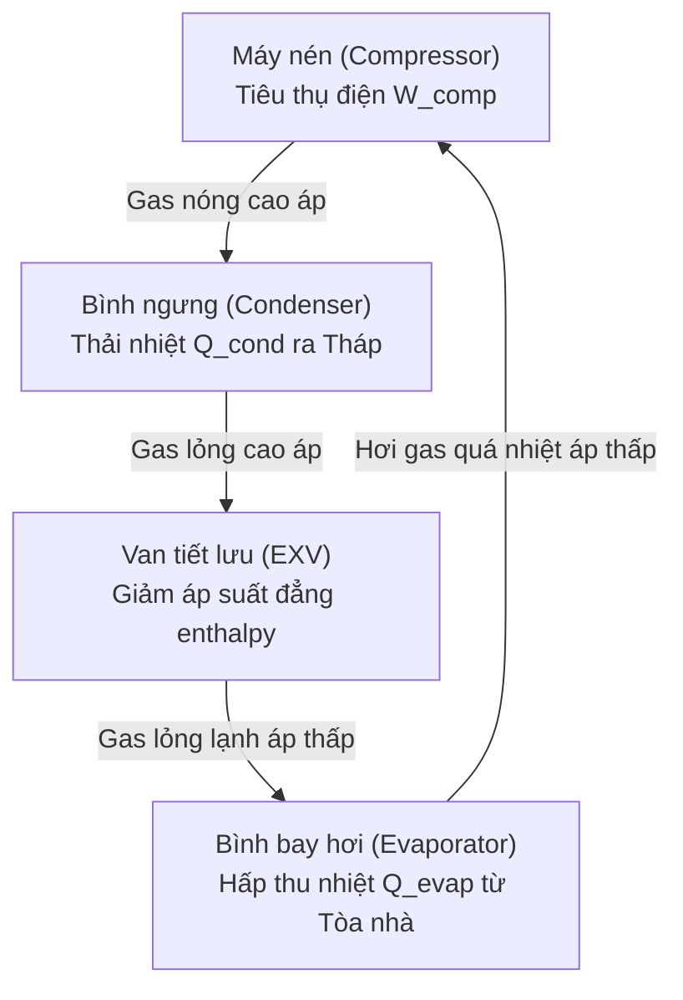
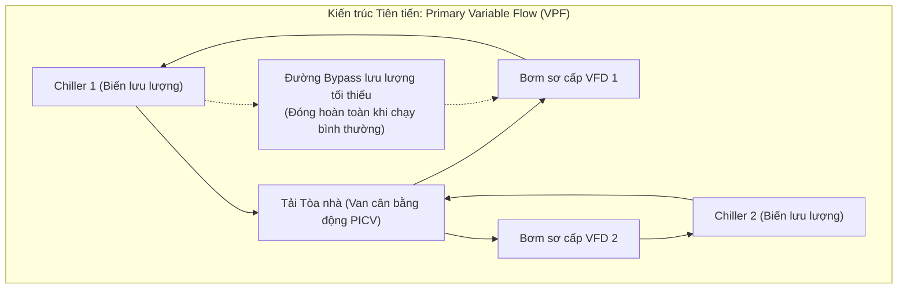

# BÀI GIẢNG 03: NGUYÊN LÝ HOẠT ĐỘNG, THIẾT KẾ TRẠM CHILLER & BƠM NHIỆT HEAT PUMP
## (Công nghệ Thiết bị, Cấu trúc Thủy lực VPF và Chiến lược Vận hành Tối ưu)

---

### MỤC TIÊU BÀI HỌC
1. **Làm chủ chu trình nén hơi (Vapor Compression Cycle):** Hiểu rõ 4 quá trình trên đồ thị $Log P - h$, bản chất cân bằng năng lượng $Q_{condenser} = Q_{evaporator} + W_{compressor}$.
2. **Nắm vững các công nghệ máy nén tiên tiến:** Chiller ly tâm (Centrifugal), Chiller ổ trục từ tính không dầu (Magnetic Bearing / Turbocor) và Chiller trục vít (Screw).
3. **So sánh bản chất 3 cấu hình thủy lực trạm lạnh:** Constant Flow $\rightarrow$ Primary-Secondary $\rightarrow$ Primary Variable Flow (VPF).
4. **Chiến lược tối ưu hóa toàn trạm (Plant System kW/RT):** Cân bằng giữa điện Chiller, điện Bơm và điện Tháp giải nhiệt. Tối ưu điểm đặt Wet-bulb Reset và Chilled Water Temp Reset.
5. **Thiết kế hệ thống Bơm nhiệt (Heat Pump):** Thu hồi nhiệt thải bình ngưng cấp nước nóng sinh hoạt $60^\circ C$ cho khách sạn/bệnh viện.

---

## PHẦN 1: NGUYÊN LÝ CHU TRÌNH NÉN HƠI & CÁC CHỈ SỐ ĐO LƯỜNG HIỆU SUẤT

### 1.1 Chu trình nhiệt động học trên đồ thị $Log P - h$
Chu trình làm lạnh nén hơi tiêu chuẩn gồm 4 quá trình liên tục khép kín:
1. **Quá trình nén đoạn nhiệt ($1 \to 2$):** Máy nén hút gas lạnh thể hơi ở áp suất thấp ($P_{evap}$), nhiệt độ thấp, nén lên áp suất cao ($P_{cond}$), nhiệt độ cao. Tiêu tốn công điện $W_{comp} = \dot{m} \cdot (h_2 - h_1)$.
2. **Quá trình ngưng tụ đẳng áp ($2 \to 3$):** Hơi gas nóng đi vào bình ngưng, thải nhiệt cho nước làm mát (hoặc gió ngoài trời) và ngưng tụ hoàn toàn thành lỏng ở đáy bình ngưng. Nhiệt lượng thải ra:
   $$Q_{condenser} = \dot{m} \cdot (h_2 - h_3) = Q_{evaporator} + W_{compressor}$$
3. **Quá trình tiết lưu đẳng enthalpy ($3 \to 4$):** Gas lỏng áp suất cao đi qua van tiết lưu điện tử (EXV), áp suất và nhiệt độ giảm đột ngột xuống điểm sôi thấp (thường $+2^\circ C$ đến $+4^\circ C$). Quá trình có $h_3 = h_4$.
4. **Quá trình sôi bay hơi đẳng áp ($4 \to 1$):** Gas lỏng lạnh đi vào bình bay hơi, nhận nhiệt từ dòng nước tuần hoàn của tòa nhà ($12^\circ C \to 7^\circ C$) để sôi bốc hơi hoàn toàn, làm nước lạnh đi. Năng suất lạnh:
   $$Q_{evaporator} = \dot{m} \cdot (h_1 - h_4)$$

### 1.2 Các chỉ số đo lường hiệu suất
- **COP (Coefficient of Performance):** Hệ số hiệu quả năng lượng không thứ nguyên:
  $$COP = \frac{Q_{evaporator}\text{ (kW)}}{W_{compressor}\text{ (kW)}}$$
- **kW/RT (Kilowatt per Refrigeration Ton):** Lượng điện tiêu thụ trên mỗi tấn lạnh ($1\text{ RT} = 3.51685\text{ kW}$):
  $$\text{kW/RT} = \frac{3.51685}{COP}$$
  > *Lưu ý:* Giá trị kW/RT càng nhỏ thì Chiller càng tiết kiệm điện!
- **IPLV / NPLV (Integrated / Non-standard Part Load Value):**
  Trong thực tế, Chiller chỉ chạy đầy tải $100\%$ dưới $1 - 2\%$ tổng số giờ trong năm. Hơn $85\%$ thời gian còn lại máy chạy non tải ở mức $40\% - 75\%$. Do đó, chuẩn AHRI 550/590 đưa ra chỉ số trung bình trọng số:
  $$IPLV = 0.01 \cdot A + 0.42 \cdot B + 0.45 \cdot C + 0.12 \cdot D$$
  - $A$: Hiệu suất tại $100\%$ tải (nước giải nhiệt vào $30^\circ C$).
  - $B$: Hiệu suất tại $75\%$ tải (nước giải nhiệt vào $24.5^\circ C$).
  - $C$: Hiệu suất tại $50\%$ tải (nước giải nhiệt vào $19^\circ C$).
  - $D$: Hiệu suất tại $25\%$ tải (nước giải nhiệt vào $19^\circ C$).

---

## PHẦN 2: CÁC CÔNG NGHỆ MÁY NÉN CHILLER TIÊN TIẾN

| Công nghệ máy nén | Dải công suất | Ưu điểm vượt trội | Nhược điểm & Rủi ro | Ứng dụng tối ưu |
| :--- | :--- | :--- | :--- | :--- |
| **Ly tâm biến tần (VFD Centrifugal)** | $300 - 3000\text{ RT}$ | Hiệu suất đầy tải và non tải cực cao ($COP > 6.5$, $IPLV > 9.5$). Bền bỉ, vận hành êm. | Nguy cơ trào ngược sóng áp (Surge) khi nhiệt độ nước giải nhiệt cao hoặc tải quá thấp $< 15\%$. | Tòa nhà văn phòng lớn, TTTM, Bệnh viện, Nhà máy 24/7. |
| **Ổ trục từ tính không dầu (Magnetic Bearing / Turbocor)** | $100 - 800\text{ RT}$ | Không dùng dầu bôi trơn $\rightarrow$ Không có ma sát, không bám dầu dàn coil làm giảm trao đổi nhiệt. Non tải siêu việt ($kW/RT < 0.32$). Dòng khởi động chỉ $2\text{ A}$. | Chi phí đầu tư ban đầu cao hơn Chiller trục vít khoảng $20 - 30\%$. | Khách sạn cao cấp, Data Center, công trình yêu cầu độ ồn rung cực thấp. |
| **Trục vít (Screw Compressor)** | $50 - 450\text{ RT}$ | Cực kỳ bền bỉ, kết cấu vững chắc, không bao giờ bị hiện tượng Surge. Chịu được dải nhiệt độ nước ngưng biến động mạnh. | Độ ồn và độ rung cơ học cao hơn ly tâm. Hiệu suất non tải trung bình ($IPLV \sim 6.5 - 7.5$). | Công trình quy mô vừa, Chiller giải nhiệt gió (Air-cooled), trạm tải thay đổi liên tục. |

---

## PHẦN 3: SO SÁNH 3 KIẾN TRÚC THỦY LỰC TRẠM LẠNH

### 3.1 Hệ thống Cổ điển (Constant Primary Flow)
- Bơm sơ cấp chạy tốc độ cố định $100\%$.
- Dùng van 3 ngả tại các AHU/FCU. Khi phòng đủ lạnh, van mở nhánh bypass xả thẳng nước $7^\circ C$ về ống hồi.
- **Hậu quả:** Tiêu tốn điện bơm tối đa 24/7, gây hội chứng Low Delta-T trầm trọng, lãng phí năng lượng khủng khiếp. Không còn được dùng trong các thiết kế hiện đại.

### 3.2 Hệ thống Sơ cấp / Thứ cấp (Primary - Secondary Flow)
- Gồm 2 vòng tuần hoàn tách biệt qua ống cầu thủy lực (Decoupler pipe):
  - Vòng sơ cấp: Chiller + Bơm sơ cấp chạy lưu lượng không đổi.
  - Vòng thứ cấp: Bơm thứ cấp có biến tần VFD phân phối nước đến các tầng theo chênh áp $\Delta P$.
- **Đánh giá:** An toàn, vận hành ổn định nhưng tốn chi phí 2 cụm bơm và chiếm diện tích phòng máy lớn.

### 3.3 Hệ thống Biến lưu lượng Sơ cấp toàn phần (Primary Variable Flow - VPF)
- **Nguyên lý:** Bỏ hoàn toàn cụm bơm thứ cấp. Chỉ sử dụng 1 cụm bơm duy nhất có biến tần VFD bơm nước trực tiếp từ Chiller lên toàn bộ tòa nhà.
- Khi tải phòng giảm, van 2 ngả (PICV) tại AHU khép lại $\rightarrow$ Cảm biến chênh áp $\Delta P$ báo về BMS $\rightarrow$ BMS giảm tần số biến tần của bơm nước lạnh.
- Lưu lượng qua bình bay hơi Chiller được phép biến thiên tự do trong dải cho phép của nhà sản xuất (thường từ $40\%$ đến $100\%$ lưu lượng định mức).
- **Cơ chế an toàn:** Lắp một van bypass điều khiển tự động nối giữa ống góp cấp và góp hồi. Khi lưu lượng toàn hệ thống tụt xuống chạm ngưỡng tối thiểu của Chiller (ví dụ $40\%$), van bypass sẽ tự động hé mở để bảo vệ Chiller không bị đóng băng ống đồng.
- **Hiệu quả:** Tiết kiệm **$25\% - 35\%$ điện năng tiêu thụ của cụm bơm**, giảm $20\%$ chi phí đầu tư thiết bị bơm và đường ống.

---

## PHẦN 4: CHIẾN LƯỢC TỐI ƯU TOÀN TRẠM (CHILLER PLANT OPTIMIZATION)

Hiệu suất năng lượng thực sự của một công trình không nằm ở COP của riêng máy Chiller, mà nằm ở **Tổng hiệu suất toàn trạm (System Plant kW/RT)**:
$$\text{Plant kW/RT} = \frac{kW_{Chiller} + kW_{Bơm\_ChW} + kW_{Bơm\_CdW} + kW_{Quạt\_Tháp}}{\text{Tổng tải lạnh thực tế (RT)}}$$

### Các chiến lược điều khiển BMS đẳng cấp cao:
1. **Tối ưu nhiệt độ nước ngưng bám sát nhiệt độ bầu ướt (Wet-bulb Approach Reset):**
   - Không cố định điểm đặt nước giải nhiệt ở $32^\circ C$. Vào những ngày mát trời hoặc ban đêm, nhiệt độ bầu ướt ngoài trời ($T_{wb}$) giảm xuống $22 - 24^\circ C$.
   - Điều khiển quạt tháp biến tần để hạ nhiệt độ nước giải nhiệt cấp vào bình ngưng Chiller xuống $25 - 26^\circ C$.
   - **Quy tắc vàng:** Cứ hạ được $1.0^\circ C$ nhiệt độ nước ngưng, máy nén Chiller giảm áp suất nén và tiết kiệm được **$1.5\% - 2.0\%$ điện năng**!
2. **Nâng nhiệt độ nước lạnh cấp (Chilled Water Temp Reset):**
   - Khi tải công trình thấp (mùa đông hoặc ban đêm), nâng nhiệt độ nước lạnh cấp từ $7.0^\circ C$ lên $8.5^\circ C$ hoặc $9.0^\circ C$.
   - Cứ nâng $1.0^\circ C$ nhiệt độ nước lạnh bay hơi, Chiller tiết kiệm được **$2.5\% - 3.0\%$ điện năng**.
3. **Phối hợp máy nén tối ưu (Sequencing & Staging theo đường cong hiệu suất):**
   - Không chạy 1 máy $100\%$ rồi mới bật máy thứ 2. Đối với Chiller ly tâm có VFD, hiệu suất tại điểm tải $55\% - 65\%$ tốt hơn nhiều so với tại $100\%$. Do đó, chạy 2 máy ở mức $50\%$ tải sẽ tiết kiệm điện hơn chạy 1 máy ở $100\%$ tải!

---

## PHẦN 5: HỆ THỐNG BƠM NHIỆT (HEAT PUMP) THU HỒI NHIỆT NƯỚC NÓNG

Đối với khách sạn 4-5 sao hoặc bệnh viện, nhu cầu nước nóng sinh hoạt ($60^\circ C$) cho tắm giặt là cực kỳ lớn.
- **Phương pháp truyền thống:** Dùng bình đun điện trở ($COP \approx 0.95$) hoặc lò hơi đốt dầu/gas tốn chi phí nhiên liệu khổng lồ.
- **Giải pháp Bơm nhiệt Heat Pump thu hồi nhiệt:**
  - Bơm nhiệt sử dụng gas lạnh thân thiện môi trường ($R134a, R1234ze, CO_2$), hút nhiệt từ nước giải nhiệt Chiller ($32^\circ C$) hoặc không khí ngoài trời để gia nhiệt nước sinh hoạt lên $60^\circ C$.
  - Hệ số hiệu quả sinh nhiệt: $COP_{heating} = COP_{cooling} + 1 \approx 4.0 - 4.5$.
  - **Hiệu quả kinh tế:** Tiết kiệm **$70\% - 75\%$ tiền điện** so với bình đun điện trở, thời gian hoàn vốn đầu tư chỉ từ **$1.2$ đến $1.8$ năm**!
