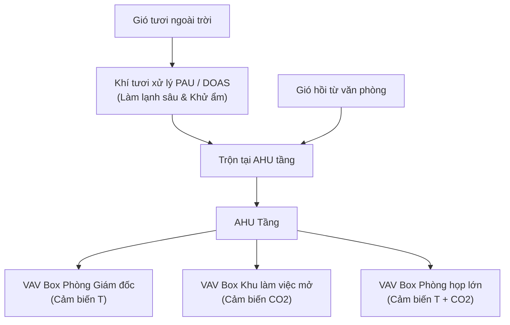
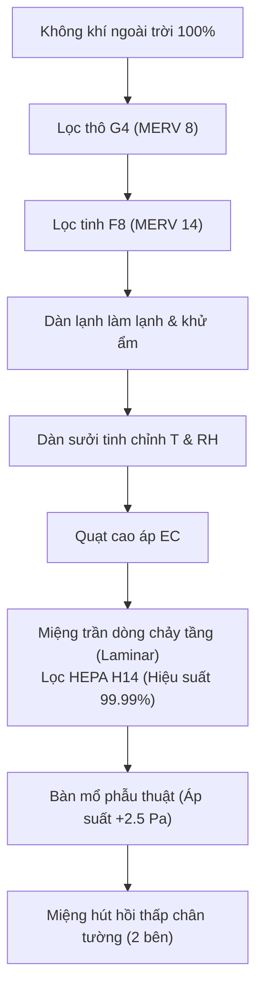
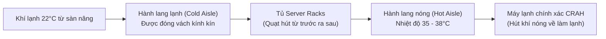

# BÀI GIẢNG 04: THIẾT KẾ MEP CHUYÊN BIỆT THEO TỪNG THỂ LOẠI CÔNG TRÌNH
## (5 Loại hình Thực chiến: Văn phòng, Khách sạn, Bệnh viện, Data Center & Nhà xưởng)

---

### MỤC TIÊU BÀI HỌC
Mỗi loại hình công trình có một "DNA kỹ thuật" hoàn toàn khác biệt. Thiết kế sai tiêu chuẩn đặc thù sẽ dẫn đến những thảm họa vận hành (ẩm mốc khách sạn, lây nhiễm chéo bệnh viện, sập máy chủ Data Center). Bài học này giúp kỹ sư:
1. Nắm vững giải pháp VAV kết hợp DOAS và điều khiển CO2 theo ASHRAE 62.1 cho **Tòa nhà Văn phòng Hạng A**.
2. Làm chủ thiết kế nước nóng Heat Pump và chống đọng sương nồm ẩm cho **Khách sạn & Resort 5 sao**.
3. Nắm vững tiêu chuẩn **ASHRAE 170** cho **Phòng mổ và Phòng cách ly Bệnh viện** (ACH, lọc HEPA, chênh áp).
4. Làm chủ tiêu chuẩn **ASHRAE TC 9.9** và tối ưu hóa **chỉ số PUE cho Trung tâm Dữ liệu (Data Center)**.
5. Thiết kế thông gió làm mát áp suất dương và hút khí thải công nghiệp cho **Nhà máy sản xuất**.

---

## LOẠI HÌNH 1: TÒA NHÀ VĂN PHÒNG HẠNG A (COMMERCIAL OFFICE)

### 1.1 Đặc thù & Thách thức thiết kế
- Tải nhiệt nội vi biến động dữ dội theo giờ làm việc (sáng thưa người, chiều đông đúc, trưa họp đông).
- Yêu cầu chất lượng không khí trong nhà (IAQ) cao: Nồng độ $CO_2 \le 800 - 1000\text{ ppm}$ để nhân viên không bị buồn ngủ, nhức đầu.
- Tiêu chuẩn độ ồn: $NC \le 35$ tại khu mở, $NC \le 30$ tại phòng họp.

### 1.2 Giải pháp kỹ thuật chuẩn mực
1. **Hệ thống lưu lượng gió biến đổi (Variable Air Volume - VAV):**
   - AHU tầng duy trì áp suất tĩnh trong ống gió cấp ở mức cố định ($250 - 350\text{ Pa}$) nhờ quạt có biến tần VFD.
   - Mỗi khu vực được lắp một hộp VAV Box (Pressure Independent VAV) có cảm biến đo lưu lượng và van cánh bướm tự động.
   - Khi phòng họp vắng người, nhiệt độ giảm $\rightarrow$ VAV box khép bớt van lại (giảm lưu lượng gió từ $100\%$ xuống mức tối thiểu $25 - 30\%$).
   - Áp suất ống gió tăng lên $\rightarrow$ Cảm biến áp suất điều khiển quạt AHU giảm tốc độ quay $\rightarrow$ **Tiết kiệm $30 - 45\%$ điện năng quạt**.
2. **Hệ thống xử lý gió tươi chuyên dụng (DOAS / PAU):**
   - Không đưa gió tươi trực tiếp vào dàn lạnh cục bộ vì không khí ẩm nhiệt đới ($W > 20\text{ g/kg}$) sẽ làm dàn bị tràn ẩm.
   - Gió tươi được xử lý tập trung tại máy PAU (Primary Air Unit): Làm lạnh sâu xuống $12 - 13^\circ C$ để ngưng tụ tách nước, đưa dung ẩm về $8.5 - 9.0\text{ g/kg}$, sau đó mới cấp vào các tầng.
3. **Điều khiển thông gió theo nhu cầu (Demand Controlled Ventilation - DCV):**
   - Lắp cảm biến $CO_2$ tại các phòng họp và khu làm việc mở.
   - Khi nồng độ $CO_2 < 600\text{ ppm}$ (ít người), van gió tươi tự động khép lại, giảm tải xử lý gió tươi cho Chiller.

---

## LOẠI HÌNH 2: KHÁCH SẠN & RESORT NGHỈ DƯỠNG (HOSPITALITY)

### 2.1 Đặc thù & Căn bệnh kinh điển
- Hoạt động 24/7, tỷ lệ lấp đầy phòng (Occupancy) biến động theo mùa du lịch ($30\% - 100\%$).
- Yêu cầu độ ồn phòng ngủ cực kỳ khắt khe: **$NC \le 25 - 28$** (Quạt FCU chạy số trung bình không được phát ra tiếng vo ve hay rung lắc).
- **Căn bệnh nồm ẩm & Đọng sương cửa kính:** Tại các khu resort ven biển (Đà Nẵng, Phú Quốc, Nha Trang), gió biển có độ ẩm cực cao ($RH > 85\%$). Nếu mở cửa ban công mà điều hòa đang bật lạnh $20^\circ C$, hơi nước ngoài trời sẽ lập tức ngưng tụ thành vũng nước trên sàn gạch và mặt kính, gây trơn trượt, mốc rèm cửa và hỏng đồ gỗ nội thất đắt tiền.

### 2.2 Giải pháp kỹ thuật bắt buộc
1. **Khóa liên động thông minh (Door Interlock Sensor):** Cảm biến từ gắn tại cửa lùa ban công. Khi khách mở cửa ban công, van điều khiển FCU/VRV lập tức đóng lại và quạt chuyển về cấp thấp nhất để triệt tiêu đọng sương.
2. **Kiểm soát áp suất dương hành lang:** Hệ thống cấp gió tươi hành lang phải luôn duy trì **áp suất dương nhẹ ($+5$ đến $+10\text{ Pa}$)** so với phòng ngủ và môi trường bên ngoài để ngăn không cho khí nóng ẩm từ sảnh lọt vào hành lang phòng ngủ.
3. **Hệ thống Nước nóng Heat Pump trung tâm:**
   - Tiêu chuẩn nước nóng: $100 - 150\text{ L/phòng/ngày}$ ở $60^\circ C$.
   - Sử dụng Bơm nhiệt thu hồi nhiệt giải nhiệt Chiller kết hợp bình chứa bảo ôn đa lớp.

---

## LOẠI HÌNH 3: BỆNH VIỆN & PHÒNG MỔ VÔ TRÙNG (HEALTHCARE - ASHRAE 170)

### 3.1 Bảng tiêu chuẩn nghiêm ngặt theo ASHRAE Standard 170 (Bảng 7.1)

| Tiêu chí kỹ thuật | Phòng mổ phẫu thuật (Operating Room) | Phòng cách ly truyền nhiễm áp âm (AII) | Phòng bảo vệ miễn dịch áp dương (PE) |
| :--- | :--- | :--- | :--- |
| **Bội số trao đổi khí tổng (Total ACH)** | $\ge \mathbf{20\text{ ACH}}$ | $\ge 12\text{ ACH}$ | $\ge 12\text{ ACH}$ |
| **Bội số gió tươi ngoài (Outdoor ACH)** | $\ge \mathbf{4\text{ ACH}}$ | $\ge 2\text{ ACH}$ | $\ge 2\text{ ACH}$ |
| **Chênh lệch áp suất (Differential Pressure)** | **Dương (+) $\ge +2.5\text{ Pa}$** | **Âm (-) $\le -2.5\text{ Pa}$** | **Dương (+) $\ge +2.5\text{ Pa}$** |
| **Hướng lưu chuyển không khí** | Từ trong phòng thổi ra hành lang | Từ hành lang hút vào trong phòng | Từ trong phòng thổi ra hành lang |
| **Cấp độ lọc khí tối thiểu** | MERV 8 + MERV 14 + **HEPA 99.99%** | MERV 8 + MERV 14 + HEPA khí thải | MERV 8 + MERV 14 + HEPA 99.99% |
| **Nhiệt độ thiết kế** | $18.0^\circ C - 22.0^\circ C$ | $21.0^\circ C - 24.0^\circ C$ | $21.0^\circ C - 24.0^\circ C$ |
| **Độ ẩm thiết kế** | $40\% - 60\%\text{ RH}$ | $40\% - 60\%\text{ RH}$ | $40\% - 60\%\text{ RH}$ |

### 3.2 Bí quyết kỹ thuật thiết kế Phòng mổ
1. **Miệng thổi trần dòng chảy tầng (Laminar Flow Ceiling Array):** Không khí vô trùng sau màng lọc HEPA được thổi thẳng đứng từ trần xuống bao trùm toàn bộ bàn mổ với vận tốc đồng đều $0.18 - 0.25\text{ m/s}$, tạo ra một "bức tường khí vô trùng" đẩy mọi hạt bụi và vi khuẩn ra xa vết mổ.
2. **Miệng hút hồi bố trí thấp ở chân tường (Low Wall Return/Exhaust):** Bố trí ít nhất 2 miệng hút ở 2 góc đối diện, mép dưới cách sàn $100 - 150\text{ mm}$ để quét sạch thuốc mê bay hơi và vi khuẩn lắng xuống sàn, tuyệt đối không hút trên trần vì sẽ tạo dòng xoáy khí cuộn ngược vi khuẩn lên bàn mổ!
3. **Phòng áp âm cách ly (AII):** $100\%$ không khí thải phải được xả thẳng lên đỉnh mái tòa nhà cách xa cửa lấy gió tươi ít nhất $10\text{ m}$, hoặc phải qua màng lọc HEPA chuyên dụng có đèn cực tím UV diệt khuẩn trước khi thải ra ngoài.

---

## LOẠI HÌNH 4: TRUNG TÂM DỮ LIỆU (DATA CENTER - ASHRAE TC 9.9)

### 4.1 Tiêu chuẩn Nhiệt ẩm ASHRAE TC 9.9 (2021)
- **Class A1 (Recommended - Khuyến nghị tối ưu):**
  - Nhiệt độ khí cấp vào mặt trước tủ Rack (Cold Aisle): **$18.0^\circ C$ đến $27.0^\circ C$** (Nhiều Data Center hiện đại duy trì ở $24 - 25^\circ C$ để tiết kiệm điện làm mát).
  - Nhiệt độ đọng sương: $T_{dp} \le 15.0^\circ C$, Độ ẩm $RH \le 60\%$.
- **Bản chất nhiệt tải IT:**
  - Thiết bị máy chủ Server chỉ sinh ra **nhiệt hiện ($SHR \approx 1.0$)**, không có nhiệt ẩm.
  - Mật độ nhiệt cực cao: Từ $4 - 6\text{ kW/rack}$ (tiêu chuẩn) đến $15 - 30\text{ kW/rack}$ (AI/High Density Server).

### 4.2 Tối ưu hóa Chỉ số Hiệu quả Năng lượng PUE (Power Usage Effectiveness)
$$PUE = \frac{\text{Tổng công suất điện toàn bộ Data Center}}{\text{Công suất điện tiêu thụ của thiết bị IT}} = \frac{P_{IT} + P_{Cooling} + P_{UPS} + P_{Phụ\_trợ}}{P_{IT}}$$
- $PUE > 1.8$: Cực kỳ lãng phí, công nghệ làm mát lạc hậu.
- $PUE = 1.3 - 1.5$: Mức trung bình của các Data Center tiêu chuẩn Tier III hiện đại.
- $PUE < 1.2$: Xuất sắc (Hyperscale Data Center dùng giải pháp Free Cooling hoặc Liquid Cooling làm mát bằng chất lỏng trực tiếp lên chip).

### 4.3 Kỹ thuật then chốt: Cô lập luồng khí (Hot/Cold Aisle Containment)
Tuyệt đối không để khí lạnh cấp và khí nóng xả tự do trộn lẫn trong phòng. Phải đóng kín hoàn toàn hành lang lạnh (Cold Aisle) hoặc hành lang nóng (Hot Aisle) bằng vách kính và cửa trượt tự động.
- **Lợi ích:** Nâng nhiệt độ gió hồi về dàn lạnh CRAH lên $35 - 38^\circ C$ giúp tăng hiệu suất trao đổi nhiệt của dàn coil lên $25\%$, đồng thời cho phép nâng nhiệt độ nước lạnh Chiller từ $7^\circ C$ lên $12 - 15^\circ C$, giúp Chiller tiết kiệm tới **$20\% - 30\%$ điện năng**!

---

## LOẠI HÌNH 5: NHÀ XƯỞNG SẢN XUẤT CÔNG NGHIỆP (INDUSTRIAL FACTORY)

### 5.1 Thách thức nhiệt động học nhà xưởng
- Không gian thể tích cực lớn (cao $8 - 14\text{ m}$, diện tích hàng chục nghìn $m^2$).
- Nhiệt bức xạ từ mái tôn và nhiệt tỏa ra từ máy móc dây chuyền may mặc, ép nhựa, gia công cơ khí.
- Bị hiện tượng phân tầng nhiệt độ (Thermal Stratification): Không khí nóng tích tụ trên cao sát mái ($40 - 45^\circ C$).

### 5.2 Giải pháp làm mát áp suất dương (Evaporative Cooling Pads)
Thay vì dùng máy lạnh Chiller tốn hàng chục tỷ tiền điện, nhà xưởng may mặc thường dùng hệ thống làm mát bay hơi áp suất dương:
- Không khí ngoài trời được quạt hút qua màng giấy trao đổi nhiệt đẫm nước (Cellulose Cooling Pad).
- Nước bay hơi đẳng enthalpy hấp thu nhiệt hiện của không khí, làm nhiệt độ không khí giảm từ $35^\circ C$ xuống $28 - 29^\circ C$ rồi thổi thẳng vào khu vực công nhân làm việc.
- Duy trì áp suất dương nhẹ để ngăn bụi và côn trùng xâm nhập từ bên ngoài.
