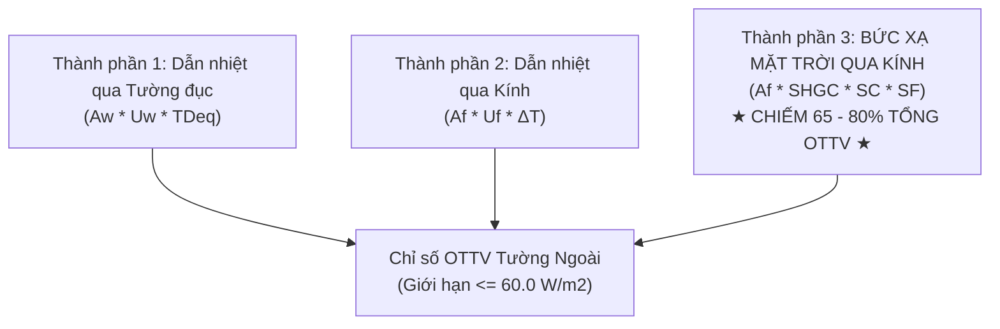

# BÀI GIẢNG 05: THẨM ĐỊNH QUY CHUẨN NĂNG LƯỢNG QCVN 09:2017 & ASHRAE 90.1
## (Làm chủ Chỉ số OTTV Vỏ bao che, Mật độ Chiếu sáng LPD & Hiệu suất Thiết bị Tối thiểu)

---

### MỤC TIÊU BÀI HỌC
Trong thực tế hành nghề thiết kế và thẩm tra kỹ thuật tại Việt Nam:
1. **QCVN 09:2017/BXD** là **quy chuẩn kỹ thuật quốc gia bắt buộc** tuân thủ theo Luật Xây dựng và Luật Sử dụng Năng lượng Tiết kiệm & Hiệu quả. Nếu hồ sơ thiết kế không đạt chỉ số OTTV hoặc LPD, dự án sẽ **bị từ chối cấp phép xây dựng hoặc không được nghiệm thu đưa vào sử dụng**.
2. **ASHRAE Standard 90.1** là tiêu chuẩn quốc tế chuẩn mực làm nền tảng cho việc đánh giá cấp chứng chỉ Công trình Xanh (**LEED, LOTUS, Green Mark**).

Bài học này giúp kỹ sư:
- Hiểu tận gốc công thức tính toán chỉ số truyền nhiệt tổng $OTTV$ (Overall Thermal Transfer Value).
- Biết cách tư vấn phối hợp với Kiến trúc sư để điều chỉnh tỷ lệ kính ($WWR$), chọn loại kính có hệ số $SHGC$ và $U-value$ tối ưu chi phí.
- Thẩm định mật độ công suất chiếu sáng ($LPD$) và công suất điện quạt ($Fan\ Power$).
- Kiểm tra tính tuân thủ của thiết bị máy nén Chiller, VRF theo Bảng hiệu suất tối thiểu (Path A & Path B).

---

## PHẦN 1: CHỈ SỐ TRUYỀN NHIỆT TỔNG VỎ BAO CHE (OTTV & ETTV)

### 1.1 Khái niệm & Giới hạn Pháp lý
OTTV (Overall Thermal Transfer Value) là thước đo nhiệt lượng truyền qua $1\text{ m}^2$ bề mặt vỏ bao che công trình (tường ngoài và mái) từ môi trường bên ngoài vào bên trong nhà có điều hòa không khí (đơn vị: $W/m^2$).
Quy định bắt buộc theo **Điều 2.1 của QCVN 09:2017/BXD**:
- **OTTV tường ngoài:** $\mathbf{OTTV_{wall} \le 60.0\text{ W/m}^2}$ (Áp dụng cho mọi công trình có diện tích sàn điều hòa $\ge 2,500\text{ m}^2$).
- **OTTV mái:** $\mathbf{OTTV_{roof} \le 25.0\text{ W/m}^2}$.

### 1.2 Công thức tính toán chi tiết OTTV Tường ngoài
$$OTTV_{wall} = \frac{(A_w \cdot U_w \cdot TD_{eq}) + (A_f \cdot U_f \cdot \Delta T) + (A_f \cdot SHGC \cdot SC \cdot SF)}{A_{total}}$$
Trong đó:
- $A_{total} = A_w + A_f$: Tổng diện tích bề mặt tường bao ngoài (gồm cả phần tường đục và phần kính cửa sổ) ($m^2$).
- $A_w$: Diện tích phần tường xây đục không trong suốt ($m^2$).
- $A_f$: Diện tích phần cửa sổ kính trong suốt ($m^2$).
- $WWR = A_f / A_{total}$: Tỷ lệ diện tích cửa sổ kính trên tổng diện tích tường (Window-to-Wall Ratio). Quy chuẩn khuyến cáo $WWR \le 0.50$.
- $U_w$: Hệ số truyền nhiệt của kết cấu tường đục ($W/m^2.K$). Tường gạch không nung $200\text{ mm}$ trát vữa 2 mặt có $U_w \approx 1.8 - 2.0\text{ W/m}^2.K$.
- $U_f$: Hệ số truyền nhiệt của hệ cửa kính ($W/m^2.K$). Kính đơn thông thường $U_f \approx 5.7\text{ W/m}^2.K$; Kính dán an toàn $U_f \approx 5.0\text{ W/m}^2.K$; Kính hộp Low-E $U_f \approx 1.8 - 2.4\text{ W/m}^2.K$.
- $TD_{eq}$: Độ chênh lệch nhiệt độ tương đương của tường đục có xét bức xạ mặt trời (theo QCVN 09 lấy $TD_{eq} = 12.0^\circ C$ cho tường gạch có khối lượng bề mặt $\ge 150\text{ kg/m}^2$).
- $\Delta T$: Độ chênh lệch nhiệt độ giữa ngoài trời và trong nhà (QCVN 09 lấy $\Delta T = 5.0^\circ C$).
- $SHGC$: Hệ số hấp thụ nhiệt bức xạ mặt trời của kính (Solar Heat Gain Coefficient).
- $SC$: Hệ số che nắng bên ngoài (External Shading Coefficient) của ô văng, lam che nắng (nếu không có lam, $SC = 1.0$).
- $SF$: Hệ số bức xạ mặt trời chuẩn hóa ($W/m^2$) theo từng hướng công trình tại Việt Nam:
  - Hướng Tây & Tây Bắc: $SF \approx 150 - 170\text{ W/m}^2$ (Hướng nắng gắt nhất).
  - Hướng Đông: $SF \approx 135 - 145\text{ W/m}^2$.
  - Hướng Nam: $SF \approx 110 - 120\text{ W/m}^2$.
  - Hướng Bắc: $SF \approx 90 - 100\text{ W/m}^2$.

> **BÍ QUYẾT TƯ VẤN KIẾN TRÚC SƯ CỦA KỸ SƯ CHUYÊN NGHIỆP:**
> Nhìn vào công thức, thành phần số 3 (Bức xạ qua kính $A_f \cdot SHGC \cdot SF$) luôn chiếm từ $65\%$ đến $80\%$ giá trị OTTV. Vì vậy:
> - Tăng độ dày tường xây từ $100\text{ mm}$ lên $200\text{ mm}$ chỉ giảm được $2 - 3\text{ W/m}^2$ OTTV.
> - Nhưng chỉ cần đổi từ kính trắng thông thường ($SHGC = 0.75$) sang kính phủ phản xạ hoặc Low-E ($SHGC = 0.32$), chỉ số OTTV sẽ **giảm ngay lập tức $25 - 35\text{ W/m}^2$**, đưa công trình từ "Rớt quy chuẩn" thành "Đạt xuất sắc"!

---

## PHẦN 2: MẬT ĐỘ CÔNG SUẤT CHIẾU SÁNG (LPD - LIGHTING POWER DENSITY)

### 2.1 Định nghĩa & Hai phương pháp thẩm tra
$$LPD = \frac{\text{Tổng công suất điện của toàn bộ đèn chiếu sáng (W)}}{\text{Tổng diện tích sàn được chiếu sáng (m}^2\text{)}}$$
1. **Phương pháp Diện tích Công trình (Building Area Method):** Áp dụng một giá trị LPD trung bình duy nhất cho toàn bộ tòa nhà.
2. **Phương pháp Không gian Chi tiết (Space-by-Space Method):** Tính toán riêng cho từng phòng/khu vực (Phòng làm việc, phòng họp, hành lang, sảnh, kho, vệ sinh).

### 2.2 Bảng đối chiếu giới hạn LPD: QCVN 09:2017 vs ASHRAE 90.1-2022

| Loại hình không gian chức năng | QCVN 09:2017/BXD ($W/m^2$) | ASHRAE 90.1-2022 ($W/m^2$) | Công nghệ đèn LED thực tế ($W/m^2$) |
| :--- | :--- | :--- | :--- |
| **Văn phòng làm việc mở** | $\le \mathbf{9.0}$ | $\le \mathbf{6.5}$ | $5.5 - 6.2$ (Đèn LED Panel 40W) |
| **Phòng họp & Hội thảo** | $\le 10.0$ | $\le 7.5$ | $6.8 - 7.2$ |
| **Hành lang & Sảnh chờ** | $\le 6.0$ | $\le 4.5$ | $3.5 - 4.2$ (LED Downlight) |
| **Phòng bệnh viện / Khám bệnh** | $\le 11.0$ | $\le 9.5$ | $8.0 - 9.0$ |
| **Phòng khách sạn** | $\le 8.0$ | $\le 6.0$ | $4.8 - 5.5$ |
| **Trung tâm thương mại / Bán lẻ** | $\le 14.0$ | $\le 9.8$ | $8.5 - 10.5$ |
| **Tầng hầm đỗ xe** | $\le 3.5$ | $\le 2.5$ | $1.8 - 2.2$ (LED Tuýp có cảm biến) |

---

## PHẦN 3: HIỆU SUẤT TỐI THIỂU CỦA THIẾT BỊ ĐIỀU HÒA KHÔNG KHÍ

Quy chuẩn bắt buộc mọi thiết bị lắp đặt vào công trình phải có chứng nhận hiệu suất đạt ngưỡng tối thiểu theo điều kiện danh định AHRI (Nhiệt độ nước lạnh $7^\circ C$, nước giải nhiệt $30^\circ C$).

### 3.1 Bảng giới hạn hiệu suất Chiller ly tâm nước $\ge 300\text{ RT}$

| Tiêu chuẩn áp dụng | COP Đầy tải ($100\%$ Load) | kW/RT Đầy tải tối đa | IPLV Non tải (COP) | IPLV (kW/RT) tối đa |
| :--- | :--- | :--- | :--- | :--- |
| **QCVN 09:2017/BXD** | $\ge \mathbf{5.70}$ | $\le \mathbf{0.617}$ | Không bắt buộc | Không bắt buộc |
| **ASHRAE 90.1-2022 (Path A - Constant speed)** | $\ge 6.10$ | $\le 0.576$ | $\ge 7.50$ | $\le 0.469$ |
| **ASHRAE 90.1-2022 (Path B - VFD biến tần)** | $\ge 5.80$ | $\le 0.606$ | $\ge \mathbf{9.30}$ | $\le \mathbf{0.378}$ |

> *Ghi chú quan trọng:* Khi thiết kế Chiller có biến tần VFD, kỹ sư nên chọn thẩm tra theo **Path B** của ASHRAE 90.1. Mặc dù COP đầy tải yêu cầu thấp hơn một chút ($5.80$ so với $6.10$), nhưng yêu cầu IPLV non tải lại cực kỳ cao ($\ge 9.30$ tương đương $\le 0.378\text{ kW/RT}$), phản ánh chính xác khả năng tiết kiệm điện vượt trội trong vận hành thực tế.

### 3.2 Giới hạn công suất điện của Quạt thông gió (Fan Power Limitation)
Theo ASHRAE Standard 90.1 Mục 6.5.3.1, tổng công suất điện của quạt cấp, quạt hồi và quạt thải không được vượt quá:
- Đối với hệ thống lưu lượng gió biến đổi VAV:
  $$P_{fan\_limit} \le 1.1\text{ W / (L/s)} \quad (\approx 1.1\text{ kW / (m}^3\text{/s)})$$
- Nếu hệ thống có dàn lọc tinh HEPA hoặc thu hồi nhiệt HRV, được cộng thêm suất công suất áp suất phụ trợ.
