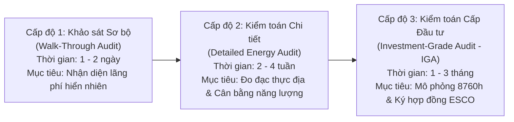
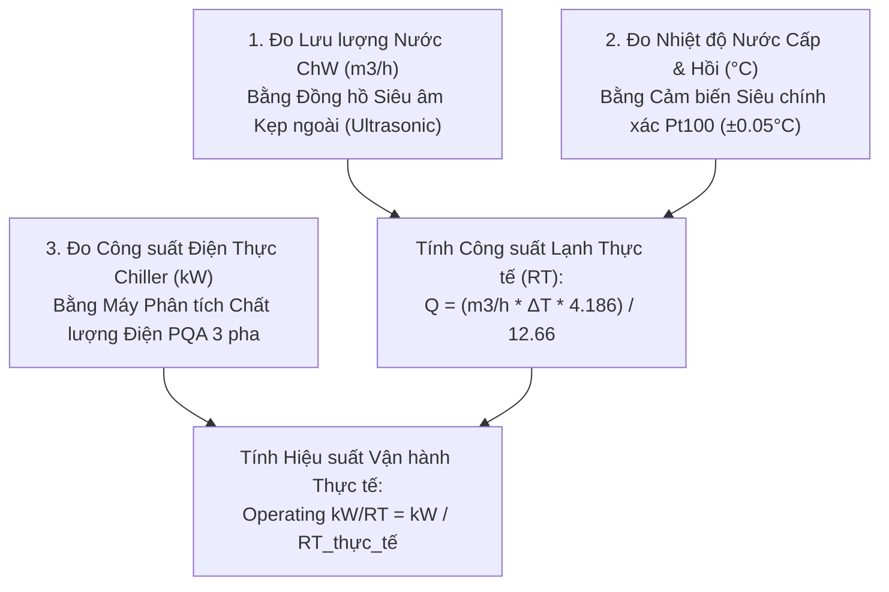

# BÀI GIẢNG 06: KIỂM TOÁN NĂNG LƯỢNG ISO 50002, ĐO KIỂM THỰC ĐỊA & PHÂN TÍCH TÀI CHÍNH LCCA
## (Từ Khảo sát Hiện trường, Bắt bệnh Hệ thống HVAC đến Lập Báo cáo Đầu tư Hiệu quả Năng lượng)

---

### MỤC TIÊU BÀI HỌC
Kiểm toán năng lượng (Energy Audit) là đỉnh cao nghề nghiệp của một kỹ sư MEP, nơi kết hợp giữa **lý thuyết nhiệt động học, kinh nghiệm vận hành thực tế và phân tích tài chính đầu tư**.
Sau bài giảng này, kỹ sư có thể:
1. **Làm chủ quy trình kiểm toán 3 cấp độ** theo TCVN ISO 50002:2015 và ASHRAE Standard 211.
2. **Thành thạo kỹ thuật đo kiểm hiện trường:** Sử dụng đồng hồ siêu âm, máy phân tích điện năng PQA, cảm biến nhiệt độ RTD Pt100.
3. **Chẩn đoán chính xác 4 "căn bệnh kinh điển" của hệ thống MEP:** Hội chứng Low Delta-T, cáu cặn bình ngưng, xung đột nhiệt và suy giảm hiệu suất tháp giải nhiệt.
4. **Thiết lập Đường cơ sở năng lượng (EnB & EnPIs)** bằng hồi quy tuyến tính độ ngày làm lạnh (CDD) theo chuẩn ASHRAE Guideline 14 & IPMVP.
5. **Đề xuất và bảo vệ các giải pháp tiết kiệm năng lượng (ECMs):** Lập mô hình tài chính dòng tiền chiết khấu (DCF), tính toán NPV, IRR, Simple Payback Period (SPB) phục vụ hợp đồng hiệu quả năng lượng (ESCO).

---

## PHẦN 1: BA CẤP ĐỘ KIỂM TOÁN NĂNG LƯỢNG (ISO 50002 & ASHRAE 211)

1. **Cấp độ 1 - Khảo sát Sơ bộ (Walk-Through Audit):**
   - Thu thập hóa đơn tiền điện 12 - 36 tháng gần nhất.
   - Đi thị sát toàn bộ công trình để phát hiện các lãng phí hiển nhiên: Đèn bật ban ngày không người, nhiệt độ phòng đặt quá lạnh ($18 - 20^\circ C$), rò rỉ khí nén, đường ống bảo ôn bị rách mục.
   - Đề xuất các giải pháp không tốn chi phí hoặc chi phí thấp (No-cost/Low-cost measures).
2. **Cấp độ 2 - Kiểm toán Năng lượng Chi tiết (Detailed Energy Audit):**
   - Lắp đặt thiết bị đo ghi (Data Loggers) liên tục từ 7 đến 14 ngày cho các hộ tiêu thụ điện lớn (Chiller, Bơm, Quạt, Chiếu sáng).
   - Lập biểu đồ phân bổ năng lượng (Sankey Diagram).
   - Tính toán chi tiết tiềm năng tiết kiệm của từng giải pháp ECMs kèm chi phí đầu tư sơ bộ CAPEX.
3. **Cấp độ 3 - Kiểm toán Cấp độ Đầu tư (Investment-Grade Audit - IGA):**
   - Đo đạc chuyên sâu dài ngày, mô phỏng năng lượng theo từng giờ (8,760 giờ/năm) bằng EnergyPlus/DOE-2.
   - Phân tích rủi ro tài chính, lập hợp đồng cam kết mức tiết kiệm năng lượng (Energy Performance Contract - EPC) giữa chủ đầu tư và công ty ESCO.

---

## PHẦN 2: QUY TRÌNH ĐO ĐẠC THỰC ĐỊA TRẠM CHILLER (FIELD MEASUREMENT)

Để đánh giá chính xác hiệu suất thực tế của Chiller ($kW/RT$), kiểm toán viên không được tin vào màn hình hiển thị của máy vì cảm biến tích hợp lâu ngày có thể bị trôi dạt (Sensor Drift). Bắt buộc phải đo đạc độc lập bằng thiết bị kiểm chuẩn:

### Yêu cầu kỹ thuật lắp đặt cảm biến tại hiện trường:
1. **Đo lưu lượng bằng sóng siêu âm (Transit-time Ultrasonic Flowmeter):**
   - Phải cạo sạch rỉ sét và lớp sơn bên ngoài ống thép, bôi gel tiếp âm dày.
   - **Quy tắc khoảng cách đoạn ống thẳng:** Vị trí kẹp đầu đo phải cách co cút, van hoặc tee tối thiểu **$10D$ (10 lần đường kính ống) ở phía trước** và **$5D$ ở phía sau** để đảm bảo dòng chảy tầng ổn định.
2. **Đo nhiệt độ nước cấp/hồi ($T_{in}, T_{out}$):**
   - Dùng cảm biến nhiệt điện trở Pt100 loại 4 dây (Class A, sai số $< \pm 0.05^\circ C$).
   - Tra mỡ tản nhiệt (Thermal Paste) vào giếng nhiệt (Thermowell) trước khi cắm cảm biến.
   - Cực kỳ cẩn trọng: Sai số nhiệt độ chỉ cần lệch $0.5^\circ C$ sẽ làm sai lệch kết quả công suất lạnh tới **$10\% - 15\%$**!
3. **Đo công suất điện Chiller ($kW$):**
   - Kẹp kìm dòng Rogowski coil và đấu que đo điện áp 3 pha tại tủ điện cấp nguồn Chiller.
   - Ghi nhận đầy đủ: Điện áp ($V$), dòng điện ($A$), hệ số công suất ($PF$) và công suất tác dụng ($kW$).

---

## PHẦN 3: BẮT BỆNH 4 CĂN BỆNH KINH ĐIỂN CỦA HỆ THỐNG HVAC

### 1. HỘI CHỨNG CHÊNH LỆCH NHIỆT ĐỘ THẤP (LOW DELTA-T SYNDROME)
* **Triệu chứng:** Nhiệt độ nước lạnh cấp đi là $7.0^\circ C$, nhưng nhiệt độ nước hồi về trạm chỉ đạt $9.5^\circ C \to 10.0^\circ C$ thay vì $12.5^\circ C$ như thiết kế. Chênh lệch nhiệt độ thực tế chỉ đạt **$\Delta T = 2.5 - 3.0^\circ C$ (thiết kế là $5.5^\circ C$)**.
* **Hậu quả kinh hoàng:**
  - Vì $\Delta T$ giảm một nửa, để đáp ứng cùng một công suất lạnh của tòa nhà, bơm nước lạnh phải bơm **gấp đôi lưu lượng nước** ($200\%$).
  - Điện năng tiêu thụ của máy bơm tăng gấp $2^{2.4} \approx 5.3$ lần!
  - Nước hồi về quá lạnh làm Chiller bị "non tải giả tạo" (mới chạy $50\%$ công suất danh định). Nhưng do lưu lượng nước đạt kịch trần ống, người vận hành lầm tưởng thiếu tải và **bật thêm Chiller thứ 2**. Kết quả: 2 Chiller cùng chạy ở mức tải thấp $35\% - 40\%$, hiệu suất $kW/RT$ tăng vọt từ $0.55$ lên $0.90\text{ kW/RT}$, gây lãng phí hàng trăm triệu tiền điện mỗi tháng!
* **Nguyên nhân gốc rễ:**
  1. Các van bypass 3 ngả cũ bị kẹt mở hoặc rò rỉ nước lạnh $7^\circ C$ xả thẳng sang đường hồi.
  2. Dàn coil AHU bị bám bụi bẩn hoặc tốc độ quạt quá cao làm gió đi qua quá nhanh không kịp trao đổi nhiệt.
  3. Hệ thống dùng van điều khiển 2 ngả truyền thống không có cân bằng áp lực, khiến các dàn FCU gần phòng máy bị thừa lưu lượng (Overflowing) làm nước chảy tuột qua dàn mà không nhận đủ nhiệt.
* **Giải pháp khắc phục:**
  - Lắp đặt van điều khiển cân bằng áp lực độc lập (Pressure Independent Control Valve - **PICV**) tại toàn bộ các dàn AHU và FCU.
  - Cân chỉnh lại điểm đặt chênh áp $\Delta P$ điều khiển bơm biến tần.

### 2. CÁU CẶN BÌNH NGƯNG CHILLER (CONDENSER TUBE FOULING)
* **Triệu chứng:** Hiệu số tiếp cận bình ngưng (Condenser Approach Temperature) tăng cao:
  $$\text{Approach} = T_{sat\_condenser}\text{ (Nhiệt độ gas lỏng bão hòa)} - T_{cw\_out}\text{ (Nhiệt độ nước ra khỏi bình ngưng)}$$
  - Khi bình ngưng sạch: $\text{Approach} \le 1.0^\circ C$.
  - Khi bị đóng cặn: $\text{Approach} \ge 2.5 - 3.5^\circ C$.
* **Hậu quả:** Cáu cặn canxi và màng sinh học có hệ số dẫn nhiệt rất kém, cản trở gas nóng truyền nhiệt cho nước. Áp suất ngưng tụ vọt lên cao $\rightarrow$ Máy nén phải làm việc nặng tải hơn.
  - **Quy tắc ngón tay cái:** Cứ Approach tăng $1.0^\circ C$, Chiller tiêu tốn thêm **$3.0\% - 3.5\%$ điện năng**.
* **Giải pháp:**
  - Định kỳ súc rửa cơ học ống chùm bình ngưng bằng chổi cọ chuyên dụng (Mechanical brush cleaning).
  - Giải pháp tối ưu: Lắp đặt **Hệ thống bóng vệ sinh tự động trực tuyến (Online Automatic Tube Cleaning System - ATCS)**. Các quả bóng xốp bọt biển được bơm tuần hoàn qua ống đồng liên tục 30 phút một lần, giữ bình ngưng luôn sạch $100\%$ không bị bám cặn suốt 365 ngày.

### 3. XUNG ĐỘT NHIỆT ĐỒNG THỜI LÀM LẠNH VÀ SƯỞI ẤM (SIMULTANEOUS HEATING & COOLING)
* **Triệu chứng:** Tại một số phòng mổ bệnh viện hoặc văn phòng có hệ thống sưởi (Reheat Coil), van nước lạnh đang mở $40\%$ nhưng dàn sưởi điện hoặc van nước nóng lại mở $25\%$ đồng thời!
* **Nguyên nhân:** Cài đặt dải chết (Deadband) tại bộ điều khiển DDC quá hẹp ($< 0.5^\circ C$) hoặc cảm biến nhiệt độ bị trôi. Thiết bị vừa làm lạnh không khí xuống sâu rồi lại lập tức bật sưởi để nâng nhiệt độ lên.
* **Giải pháp:** Cài đặt lại thuật toán điều khiển BMS: Tách biệt dải chết tối thiểu $1.5^\circ C$ giữa chế độ làm mát và sưởi. Khóa liên động van lạnh đóng hoàn toàn mới được phép kích hoạt sưởi.

---

## PHẦN 4: THIẾT LẬP ĐƯỜNG CƠ SỞ NĂNG LƯỢNG (ENERGY BASELINE & ENPIs)

Theo chuẩn **ISO 50001 & ASHRAE Guideline 14**, để đo lường chính xác lượng điện tiết kiệm sau khi cải tạo, không thể lấy điện năm nay trừ đi năm ngoái (vì thời tiết mùa hè năm nay có thể nóng hơn năm ngoái). Bắt buộc phải lập **Mô hình hồi quy đường cơ sở (Baseline Regression Model)** theo độ ngày làm lạnh (Cooling Degree Days - CDD):
$$E_{base}\text{ (kWh/tháng)} = a + b \cdot CDD$$
Trong đó:
- $a$: Tải năng lượng nền không phụ thuộc thời tiết (Chiếu sáng, máy tính, thang máy, bơm cấp nước).
- $b$: Hệ số nhạy cảm thời tiết (Mỗi độ CDD tăng thêm làm tăng bao nhiêu kWh điện chạy điều hòa).
- $CDD$: Tổng độ ngày làm lạnh trong tháng tính theo nhiệt độ cơ sở $18.3^\circ C$ ($65^\circ F$):
  $$CDD = \sum_{days} \max(0, T_{mean\_daily} - 18.3)$$

### Tiêu chí kiểm định mô hình theo ASHRAE Guideline 14:
- Hệ số tương quan xác định: $R^2 \ge 0.75$.
- Sai số bình phương trung bình chuẩn hóa: $CV(RMSE) \le 15\%$.
- Sai số trung bình phân số: $NMBE \le \pm 5\%$.
Lượng điện tiết kiệm thực tế theo giao thức **IPMVP Option C**:
$$\text{Energy Savings} = E_{baseline\_dự\_báo}(CDD_{năm\_nay}) - E_{thực\_tế\_đo\_được}(năm\_nay)$$

---

## PHẦN 5: PHÂN TÍCH HIỆU QUẢ TÀI CHÍNH ĐẦU TƯ (LCCA: NPV, IRR, SPB)

Một báo cáo kiểm toán năng lượng chỉ có giá trị khi thuyết phục được Giám đốc Tài chính (CFO) chi tiền đầu tư. Kỹ sư phải thành thạo 3 chỉ tiêu tài chính:

### 1. Thời gian hoàn vốn giản đơn (Simple Payback Period - SPB):
$$SPB\text{ (Năm)} = \frac{CAPEX\text{ (Tổng chi phí đầu tư thiết bị và thi công)}}{\text{Tiết kiệm tiền điện ròng hàng năm (VNĐ/năm)}}$$
- Tiêu chuẩn đầu tư ESCO: $SPB \le 2.5 - 3.0\text{ năm}$ là dự án cực kỳ hấp dẫn!

### 2. Hiện giá thuần (Net Present Value - NPV):
Phản ánh toàn bộ giá trị thặng dư bằng tiền của dự án quy về thời điểm hiện tại, có xét đến tỷ suất chiết khấu (lãi suất vay ngân hàng hoặc chi phí sử dụng vốn bình quân WACC $r \approx 8\% - 10\%$):
$$NPV = -CAPEX + \sum_{t=1}^{N} \frac{CF_t}{(1 + r)^t}$$
- $N$: Tuổi thọ dự án (thường lấy $10 - 15\text{ năm}$ cho hệ thống HVAC).
- $CF_t$: Dòng tiền tiết kiệm ròng năm thứ $t$.
- **Quy tắc quyết định:** Dự án khả thi khi $NPV > 0$.

### 3. Tỷ suất sinh lời nội hàm (Internal Rate of Return - IRR):
Là mức lãi suất chiết khấu mà tại đó $NPV = 0$.
- Nếu $IRR > 25\% - 30\%$, dự án có hiệu quả sinh lời vượt trội hơn gửi ngân hàng hoặc đầu tư sản xuất kinh doanh thông thường!

### Bảng minh họa phân tích tài chính giải pháp Lắp biến tần VFD cho Bơm:
- Chi phí đầu tư trọn gói (2 biến tần 37kW + cảm biến chênh áp + cáp): $180,000,000\text{ VNĐ}$.
- Tiết kiệm điện đo đạc: $115,000\text{ kWh/năm} \times 2,300\text{ VNĐ/kWh} = 264,500,000\text{ VNĐ/năm}$.
- Chi phí bảo dưỡng tăng thêm: $10,000,000\text{ VNĐ/năm}$.
- Dòng tiền ròng hàng năm: $CF = 254,500,000\text{ VNĐ/năm}$.
- **Thời gian hoàn vốn:** $SPB = \frac{180}{254.5} = \mathbf{0.71\text{ năm (~ 8.5 tháng)}}!$
- **Hiện giá thuần NPV (15 năm, r = 8%):** **$+1,997,000,000\text{ VNĐ}$** (Gần 2 tỷ đồng lợi nhuận ròng).
- **Tỷ suất hoàn vốn nội hàm IRR:** **$141.3\%$** $\rightarrow$ Phương án đầu tư siêu lợi nhuận.
