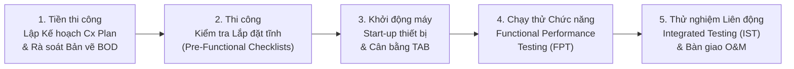
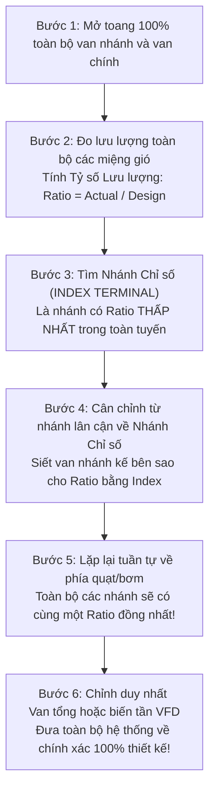

# BÀI GIẢNG 07: CHẠY THỬ NGHIỆM THU (Cx), CÂN BẰNG HỆ THỐNG (TAB) & CHẨN ĐOÁN LỖI TỰ ĐỘNG (FDD)
## (Biến Bản vẽ Thiết kế thành Hệ thống Vận hành Hoàn hảo Đạt chuẩn Quốc tế)

---

### MỤC TIÊU BÀI HỌC
Một bản vẽ thiết kế hoàn hảo trên giấy chỉ quyết định $50\%$ thành công của dự án. $50\%$ còn lại phụ thuộc vào **Quy trình Chạy thử Nghiệm thu (Commissioning - Cx)** và **Cân bằng Thủy lực / Khí động (TAB)**.
Sau bài học này, kỹ sư có thể:
1. **Làm chủ quy trình Commissioning (Cx)** theo chuẩn quốc tế **ASHRAE Guideline 0 & 1.1**.
2. **Thực hiện cân bằng mạng gió và mạng nước** theo Phương pháp Cân bằng Tỷ lệ (Proportional Balancing) chuẩn **NEBB / AABC** đạt dung sai $\pm 10\%$.
3. **Hiểu rõ chiến lược điều khiển BMS hiệu năng cao** theo **ASHRAE Guideline 36**.
4. **Xây dựng hệ thống phát hiện lỗi và chẩn đoán tự động (Automated Fault Detection and Diagnostics - FDD)** giúp ban quản lý tòa nhà giám sát hiệu suất 24/7.

---

## PHẦN 1: QUY TRÌNH COMMISSIONING CHUẨN ASHRAE GUIDELINE 0 & 1.1

Commissioning (Cx) là quy trình đảm bảo toàn bộ hệ thống cơ điện được lắp đặt, kiểm tra, vận hành và nghiệm thu đúng với **Yêu cầu của Chủ đầu tư (Owner's Project Requirements - OPR)** và **Cơ sở Thiết kế (Basis of Design - BOD)**.

### 3 Cột mốc Nghiệm thu bắt buộc của Kỹ sư Cx:
1. **Kiểm tra Tiền chức năng (Pre-Functional Checklist - PFC):**
   - Kiểm tra chiều quay của cánh quạt và cánh bơm (rất nhiều quạt chạy ngược pha làm lưu lượng gió tụt $50\%$).
   - Kiểm tra hướng dòng chảy của van 1 chiều (Check valve), đồng hồ áp suất, lọc y (Strainer) đã được tháo lưới súc rửa sạch mạt hàn chưa.
   - Kiểm tra vị trí lắp đặt cảm biến nhiệt độ giếng nhiệt đã có mỡ tiếp xúc chưa.
2. **Thử nghiệm Tính năng Hoạt động (Functional Performance Testing - FPT):**
   - Thử nghiệm các chế độ điều khiển: Tự động (Auto), Bằng tay (Manual), Chế độ khẩn cấp (Emergency).
   - Kiểm tra khả năng điều chỉnh của biến tần khi thay đổi điểm đặt áp suất $\Delta P$.
   - Thử nghiệm chức năng chống đông bình bay hơi Chiller (Freeze Protection): Giả lập nhiệt độ nước lạnh tụt xuống $3.5^\circ C$, máy nén phải tự động ngắt an toàn.
3. **Thử nghiệm Tích hợp Toàn diện (Integrated System Testing - IST):**
   - Kích hoạt tín hiệu Báo cháy trung tâm (Fire Alarm Trigger):
     + Toàn bộ quạt cấp gió tươi và điều hòa không khí AHU/FCU phải **ngắt nguồn điện ngay lập tức trong vòng 3 giây** để không thổi oxy nuôi đám cháy.
     + Hệ thống quạt hút khói hành lang và quạt tăng áp buồng thang thoát hiểm phải **tự động khởi động $100\%$ công suất** để tạo chênh lệch áp suất dương $+30$ đến $+50\text{ Pa}$ chống khói độc tràn vào cầu thang.

---

## PHẦN 2: PHƯƠNG PHÁP CÂN BẰNG TỶ LỆ (PROPORTIONAL BALANCING METHOD)

Theo tiêu chuẩn quốc tế **NEBB** (National Environmental Balancing Bureau), hệ thống phân phối gió và nước được coi là đạt tiêu chuẩn nghiệm thu khi:
$$0.90 \le \frac{\text{Lưu lượng thực tế đo được (Actual Flow)}}{\text{Lưu lượng thiết kế (Design Flow)}} \le 1.10 \quad (\text{Dung sai } \pm 10\%)$$

### 2.1 Tại sao phải dùng Phương pháp Tỷ lệ?
Khi bạn siết một van nhánh này để giảm bớt lưu lượng thừa, áp suất trong ống góp sẽ tăng lên làm lưu lượng ở TẤT CẢ các van nhánh khác tăng theo! Nếu cân chỉnh mò mẫm từng miệng gió, bạn sẽ phải chạy vòng quanh chỉnh lại hàng trăm lần mà không bao giờ cân bằng được.
Phương pháp cân bằng tỷ lệ giải quyết triệt để vấn đề này nhờ nguyên lý: **Tỷ lệ lưu lượng giữa các nhánh con không thay đổi khi van tổng thay đổi!**

---

## PHẦN 3: HỆ THỐNG CHẨN ĐOÁN LỖI TỰ ĐỘNG (AUTOMATED FDD)

Hệ thống FDD sử dụng các thuật toán dựa trên luật chuyên gia (Rule-based FDD) kết hợp cảm biến BMS để phát hiện và khoanh vùng sự cố vận hành ngay khi mới phát sinh, ngăn ngừa lãng phí năng lượng trước khi có hóa đơn tiền điện cuối tháng.

### Bảng 5 Quy tắc FDD Vàng của Hệ thống HVAC:

| Mã quy tắc | Tên lỗi vận hành | Điều kiện kích hoạt thuật toán FDD | Hậu quả kỹ thuật | Phương án xử lý |
| :--- | :--- | :--- | :--- | :--- |
| **FDD-01** | **Xung đột Nhiệt AHU** | $V_{cooling} > 15\%$ VÀ $V_{heating} > 10\%$ trong thời gian liên tục $> 5\text{ phút}$. | Vừa làm lạnh vừa sưởi, lãng phí năng lượng kép. | Tăng dải chết Deadband lên $1.5^\circ C$, khóa liên động van lạnh đóng kín mới mở van sưởi. |
| **FDD-02** | **Cáu cặn Bình ngưng Chiller** | Approach bình ngưng $(T_{sat\_cond} - T_{cw\_out}) > 2.0^\circ C$ ở mức tải Chiller $> 60\%$. | Tiêu tốn thêm $4 - 8\%$ điện Chiller, tăng nguy cơ nổ áp cao. | Vệ sinh cơ học ống chùm bình ngưng hoặc kích hoạt hệ thống bóng vệ sinh tự động ATCS. |
| **FDD-03** | **Kẹt van Gió tươi Damper** | Nhiệt độ hòa trộn $T_{mix} \approx T_{outdoor}$ dù tín hiệu van gió tươi chỉ đặt $15\%$. | Tràn ngập không khí nóng ẩm ngoài trời vào phòng, quá tải Chiller. | Kiểm tra mô tơ cơ cấu chấp hành (Actuator) van gió tươi bị trượt khớp hoặc kẹt cơ khí. |
| **FDD-04** | **Bơm chạy quá tốc độ khi Low Delta-T** | Tần số bơm ChW đạt $50\text{ Hz}$ ($100\%$) nhưng công suất Chiller mới đạt $< 50\%$. | Bơm tiêu tốn tối đa điện năng vô ích, Chiller bị non tải giả tạo. | Kiểm tra các van bypass 3 ngả bị rò rỉ, lắp van cân bằng động PICV tại các cuộn coil AHU. |
| **FDD-05** | **Trôi cảm biến nhiệt độ gió cấp** | Nhiệt độ gió cấp $T_{supply}$ đo được lệch $> 2.0^\circ C$ so với cảm biến kiểm chuẩn. | Phòng bị quá lạnh hoặc quá nóng, bộ điều khiển PID bị dao động (Hunting). | Hiệu chuẩn lại cảm biến Pt100/NTC hoặc thay thế cảm biến bị ẩm hỏng. |
